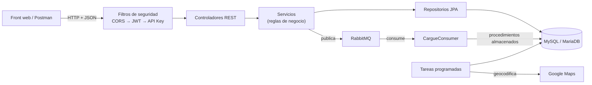
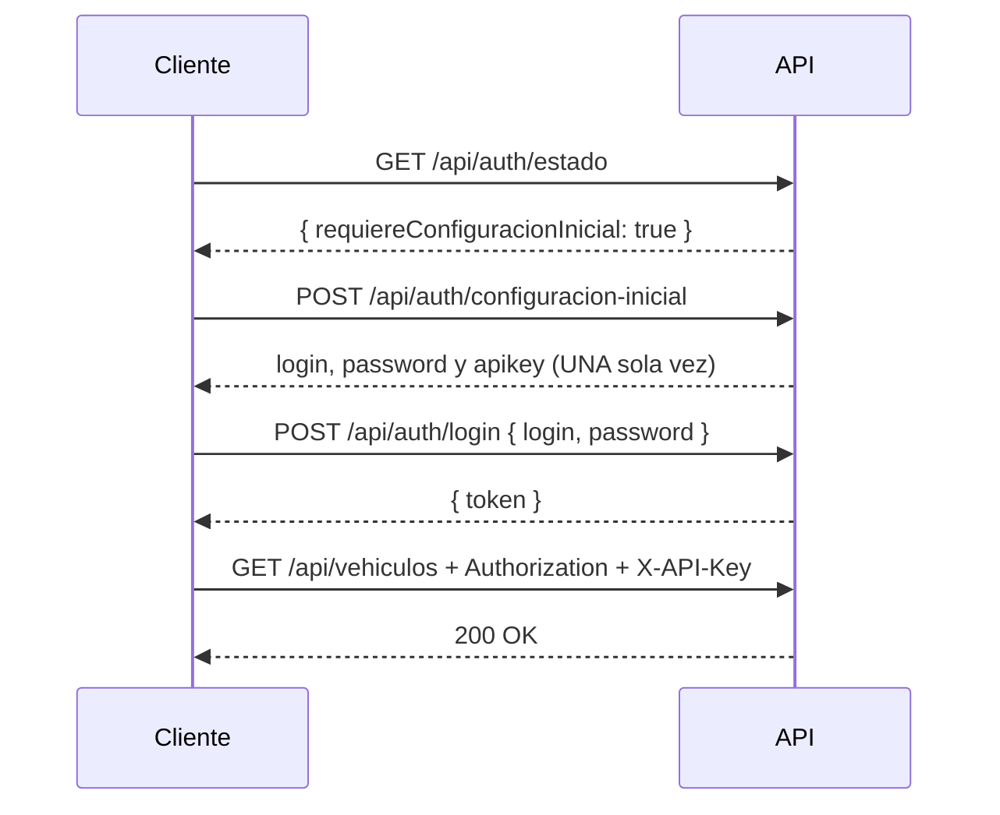
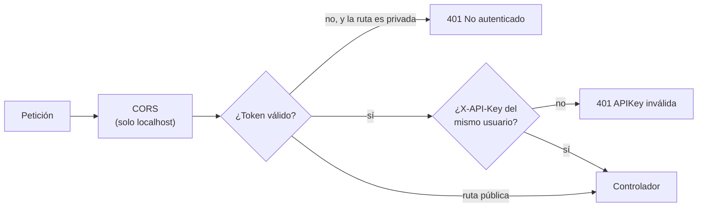
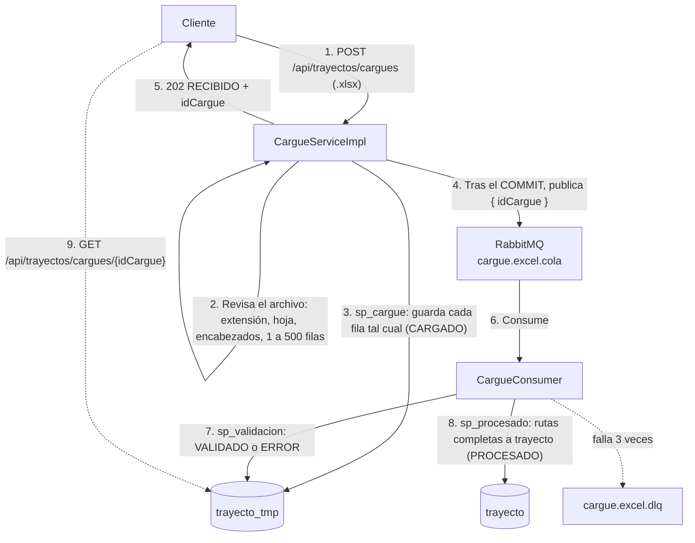

# Documentación de la API · Vehículos, Documentos y Trayectos

API REST para administrar una flota de transporte: **vehículos y sus documentos legales, conductores, rutas (trayectos) y el cargue masivo de rutas desde Excel**.

> Proyecto académico de *Profundización en Programación Orientada a Objetos II*, Universidad del Tolima.
> Spring Boot 4.0.8 · Java 17 · MySQL/MariaDB · RabbitMQ · Apache POI · Google Maps.

---

## Contenido

1. [¿Qué es y para qué sirve?](#1-qué-es-y-para-qué-sirve)
2. [Cómo ejecutarla](#2-cómo-ejecutarla)
3. [Seguridad: URLs públicas y privadas](#3-seguridad-urls-públicas-y-privadas)
4. [Convenciones: formatos, códigos y errores](#4-convenciones-formatos-códigos-y-errores)
5. [Endpoints públicos](#5-endpoints-públicos)
6. [Endpoints privados](#6-endpoints-privados)
7. [Reglas de negocio](#7-reglas-de-negocio)
8. [Tareas programadas](#8-tareas-programadas)
9. [Cargue masivo desde Excel y RabbitMQ](#9-cargue-masivo-desde-excel-y-rabbitmq)
10. [Resumen de todos los endpoints](#10-resumen-de-todos-los-endpoints)
11. [Limitaciones conocidas](#11-limitaciones-conocidas)

---

## 1. ¿Qué es y para qué sirve?

### Finalidad

Una empresa de transporte necesita saber, en todo momento, **qué vehículos y qué conductores pueden salir a operar**. Para eso hay que controlar:

- que cada vehículo tenga sus **documentos legales** (SOAT, técnico-mecánica…) vigentes y verificados;
- que cada conductor esté **autorizado** para el vehículo que maneja y tenga la **licencia** al día;
- que las **rutas** se registren solo con vehículos habilitados y conductores autorizados.

La API centraliza esa información y **aplica las reglas automáticamente**: no deja crear una ruta con un vehículo que tenga documentos sin habilitar, marca como vencidos los documentos cuya fecha pasó, restringe a los conductores con la licencia vencida y completa las coordenadas de las paradas con Google Maps.

### Quién la usa

| Actor | Qué hace | Acceso |
|---|---|---|
| **Ciudadano / público** | Consulta qué vehículos tienen documentos vencidos, qué conductores pueden operar, el detalle de un vehículo por placa o las rutas restringidas. | URLs públicas, sin credenciales |
| **Administrativo** | Registra vehículos, documentos, personas, conductores y rutas; carga rutas desde Excel. | URLs privadas: token JWT + API Key |
| **Tareas programadas** | Vencen documentos y licencias, y geocodifican paradas. | Internas (no son endpoints) |

### Módulos

| Módulo | Para qué sirve | Entrega |
|---|---|---|
| **Documentos** | Catálogo de tipos de documento que se exigen (SOAT, RTM…) y a qué tipo de vehículo aplican. | 1 |
| **Vehículos** | Registro de la flota y de los documentos de cada vehículo (fechas, estado y PDF). | 1 |
| **Personas y usuarios** | Conductores y administrativos. Cada administrativo recibe un usuario, una contraseña y una API Key. | 2 |
| **Conductores por vehículo** | Qué conductor puede manejar qué vehículo y en qué estado está (PO, EA, RO). | 2 |
| **Consultas públicas** | Información abierta sobre el estado de la flota. | 2 y 3 |
| **Trayectos (rutas)** | Rutas de 2 a 7 paradas, con conductor y vehículo. | 3 |
| **Cargue masivo** | Importar muchas rutas desde un Excel, con validación en segundo plano. | 4 |

### Arquitectura



---

## 2. Cómo ejecutarla

### Requisitos

| Pieza | Versión | Para qué |
|---|---|---|
| JDK | 17 o superior | Compilar y ejecutar la API |
| MySQL / MariaDB | XAMPP | Base de datos `transporte` |
| Docker Desktop | — | RabbitMQ (y opcionalmente la API) |
| Clave de Google Maps | Geocoding API | Opcional: completar coordenadas |

### Pasos

1. **Base de datos.** Inicia MySQL en XAMPP. En la base `transporte`, ejecuta `sql/entrega4_trayecto_tmp.sql` y luego `sql/entrega4_procedimientos.sql`.
2. **RabbitMQ.**
   ```bash
   docker compose up -d rabbitmq
   ```
   Consola: <http://localhost:15672> (usuario `guest`, clave `guest`).
3. **La API**, con una de estas dos opciones:
   ```bash
   ./mvnw spring-boot:run
   ```
   ```bash
   docker compose up -d --build
   ```
4. **Primer usuario.** Si la base no tiene usuarios, crea el primer administrador con `POST /api/auth/configuracion-inicial` (sección 5.2) o desde el front.

**URL base:** `http://localhost:8080`

### Configuración principal (`application.properties`)

| Propiedad | Valor | Significado |
|---|---|---|
| `spring.datasource.url` | `jdbc:mysql://localhost:3306/transporte` | Base de datos |
| `jwt.expiration-ms` | `3600000` | El token dura **1 hora** |
| `google.maps.api-key` | variable `GOOGLE_MAPS_API_KEY` | Sin clave, no se completan coordenadas |
| `spring.servlet.multipart.max-file-size` | `2MB` | Tamaño máximo del Excel |
| `spring.rabbitmq.listener.simple.retry.max-attempts` | `3` | Reintentos antes de la cola de fallidos |

---

## 3. Seguridad: URLs públicas y privadas

### Qué es público y qué es privado

| Tipo | Rutas | Credenciales |
|---|---|---|
| **Públicas** | `/api/publico/**` y `/api/auth/**` | Ninguna |
| **Privadas** | Todas las demás (`/api/vehiculos/**`, `/api/documentos/**`, `/api/personas/**`, `/api/usuarios/**`, `/api/trayectos/**`) | **Las dos cabeceras** de abajo |

Cada petición privada debe llevar **dos cabeceras**:

```http
Authorization: Bearer <token JWT>
X-API-Key: <API Key del mismo usuario>
```

- **El token JWT** se obtiene con `POST /api/auth/login` y vence a la hora.
- **La API Key** se entrega **una sola vez**: al crear el usuario o al regenerarla. No se puede volver a consultar.
- Los dos datos deben ser **del mismo usuario**. El token de un usuario con la API Key de otro responde 401.

### Cómo obtener las credenciales



### Cómo se revisa cada petición



| Situación | Respuesta |
|---|---|
| Sin token, o con un token vencido o mal firmado | `401` · `"No autenticado: token JWT ausente, inválido o expirado"` |
| Token válido, pero API Key ausente o de otro usuario | `401` · `"APIKey inválida o ausente en el header X-API-Key"` |
| Intentar cambiar la contraseña o la API Key de **otro** usuario | `403` · `"Solo puedes cambiar las credenciales de tu propio usuario."` |

### CORS

Solo los orígenes `http://localhost:*` y `http://127.0.0.1:*` pueden llamar a la API desde un navegador. Están permitidos los métodos `GET`, `POST`, `PUT`, `DELETE` y `OPTIONS`, y las cabeceras `Authorization`, `Content-Type` y `X-API-Key`. En un despliegue real, se cambia por el dominio del front.

### Ejemplos con `curl`

Los ejemplos de esta guía usan dos variables:

```bash
TOKEN="eyJhbGciOiJIUzI1NiJ9..."
APIKEY="3f1c2b7e-...-9a8d"
```

---

## 4. Convenciones: formatos, códigos y errores

### Formatos

- **Cuerpo:** JSON (`Content-Type: application/json`), excepto el Excel, que se envía como `multipart/form-data`.
- **Fechas:** `yyyy-MM-dd`, por ejemplo `2026-12-31`.
- **Archivos PDF** (documentos y licencias): texto **Base64** que empieza por `JVBERi0`, que es `%PDF-` codificado.

### Códigos de las listas fijas (enums)

Se envían y se reciben **con el código**, no con el nombre.

| Campo | Código → significado |
|---|---|
| `tipoVehiculo` | `AUTOMOVIL` · `MOTOCICLETA` |
| `tipoServicio` | `Pu` = público · `Pr` = privado |
| `tipoCombustible` | `Gasolina` · `Gas` · `Disel` = diésel (sin «e», así está en la base de datos) |
| `estadoDocumento` | `En Verificacion` · `Habilitado` · `Vencido` |
| `tipoVehiculoAplica` (documento) | `A` = automóvil · `M` = motocicleta · `AM` = ambos |
| `obligatoriedad` (documento) | `RA` = requerido para automóvil · `RM` = requerido para motocicleta · `RR` = requerido para ambos |
| `tipoPersona` | `C` = conductor · `A` = administrativo |
| `tipoIdentificacion` | `CC` = cédula de ciudadanía |
| `estadoConductor` | `PO` = puede operar · `EA` = en espera de aprobación · `RO` = restringido para operar |
| `motivo` (ruta restringida) | `VEHICULO_NO_HABILITADO` · `CONDUCTOR_RESTRINGIDO` · `AMBOS` |
| Estados del cargue | `CARGADO` · `VALIDADO` · `PROCESADO` · `ERROR` |

### Formato de error

Todos los errores tienen la misma forma (`ErrorResponseDTO`):

```json
{
  "fecha": "2026-11-04T15:30:00",
  "estado": 400,
  "mensaje": "Error de validación",
  "detalles": ["placa: size must be between 6 and 6", "color: must match \"^#[0-9A-Fa-f]{6}$\""]
}
```

`detalles` solo viene en los errores de validación de campos (`@Valid`), con el formato `"campo: mensaje"`. En los demás casos es `null`.

### Códigos HTTP

| Código | Cuándo |
|---|---|
| `200 OK` | Consulta o actualización correcta |
| `201 Created` | Recurso creado |
| `202 Accepted` | Excel recibido; se procesa en segundo plano |
| `204 No Content` | Correcto, sin cuerpo (eliminar, cambiar contraseña, cargar PDF) |
| `400 Bad Request` | Validación de campos o regla de negocio incumplida |
| `401 Unauthorized` | Falta el token o la API Key, o no son válidos |
| `403 Forbidden` | Acción sobre credenciales de otro usuario |
| `404 Not Found` | El recurso no existe. **También** login con usuario o contraseña incorrectos |
| `413 Payload Too Large` | Archivo de más de 2 MB |

---

## 5. Endpoints públicos

No llevan cabeceras de seguridad.

### 5.1 Estado del sistema

Indica si el sistema todavía no tiene usuarios. El front lo usa para decidir si muestra «Crear el primer administrador».

```bash
curl http://localhost:8080/api/auth/estado
```

```json
{ "requiereConfiguracionInicial": true }
```

### 5.2 Crear el primer administrador

Solo funciona mientras **no exista ningún usuario**. Crea una persona ADMINISTRATIVA y genera su usuario, su contraseña y su API Key.

```bash
curl -X POST http://localhost:8080/api/auth/configuracion-inicial \
  -H "Content-Type: application/json" \
  -d '{
    "identificacion": "1098765432",
    "tipoIdentificacion": "CC",
    "nombres": "Ana",
    "apellidos": "Rojas",
    "correoElectronico": "ana.rojas@ejemplo.com",
    "tipoPersona": "A"
  }'
```

**`201 Created`.** Las credenciales vienen **solo en esta respuesta**:

```json
{
  "idPersona": 1,
  "identificacion": "1098765432",
  "tipoIdentificacion": "CC",
  "nombres": "Ana",
  "apellidos": "Rojas",
  "correoElectronico": "ana.rojas@ejemplo.com",
  "tipoPersona": "A",
  "usuario": {
    "login": "ar1098765432",
    "password": "a1b2c3d4",
    "apikey": "3f1c2b7e-5d4a-4e8b-9c1f-2a7d6e5b9a8d"
  },
  "fechaVigenciaLicencia": null,
  "tieneLicencia": false
}
```

| Error | Respuesta |
|---|---|
| Ya existe al menos un usuario | `400` · `"El sistema ya fue configurado. Inicie sesion con un usuario existente."` |
| Faltan campos o el correo no es válido | `400` · `"Error de validación"` con `detalles` |

### 5.3 Iniciar sesión

```bash
curl -X POST http://localhost:8080/api/auth/login \
  -H "Content-Type: application/json" \
  -d '{ "login": "ar1098765432", "password": "a1b2c3d4" }'
```

```json
{ "token": "eyJhbGciOiJIUzI1NiJ9.eyJzdWIiOiJhcjEwOTg3NjU0MzIiLCJpYXQiOjE3OTM..." }
```

| Error | Respuesta |
|---|---|
| Usuario o contraseña incorrectos | `404` · `"Login o password incorrectos"` (no dice cuál de los dos, a propósito) |
| `login` o `password` vacíos | `400` · `"Error de validación"` |

> El login **no revisa la API Key**: eso ocurre en la primera petición privada.

### 5.4 Consultas públicas

| # | Método y URL | Qué devuelve |
|---|---|---|
| 1 | `GET /api/publico/vehiculos/documentos-vencidos` | Vehículos con al menos un documento `Vencido` |
| 2 | `GET /api/publico/vehiculos/documentos-por-vencer?dias=30` | Vehículos con algún documento que vence **entre hoy y hoy + `dias`** |
| 3 | `GET /api/publico/conductores-disponibles` | Personas que están en `PO` con algún vehículo |
| 4 | `GET /api/publico/vehiculos/placa/{placa}` | Ficha completa: el vehículo, sus documentos y sus conductores |
| 5 | `GET /api/publico/personas/conteo-por-tipo` | Cuántas personas hay de cada tipo |
| 6 | `GET /api/publico/trayectos/rutas-restringidas` | Rutas cuyo vehículo no está habilitado o cuyo conductor está en `RO` |

**Ejemplo 1: documentos vencidos**

```bash
curl http://localhost:8080/api/publico/vehiculos/documentos-vencidos
```

Devuelve una lista de vehículos con la misma forma que el ejemplo 2. Al menos uno de sus documentos tiene `"estadoDocumento": "Vencido"`.

**Ejemplo 2: documentos por vencer en 30 días**

```bash
curl "http://localhost:8080/api/publico/vehiculos/documentos-por-vencer?dias=30"
```

```json
[
  {
    "id": 1,
    "tipoVehiculo": "AUTOMOVIL",
    "placa": "ABC123",
    "tipoServicio": "Pu",
    "tipoCombustible": "Gasolina",
    "capacidadPasajeros": 4,
    "color": "#1558C9",
    "modelo": 2020,
    "marca": "Chevrolet",
    "linea": "Spark",
    "documentos": [
      {
        "idDocumento": 1,
        "codigoDocumento": "SOAT",
        "nombreDocumento": "Seguro obligatorio",
        "fechaExpedicion": "2025-12-01",
        "fechaVencimiento": "2026-11-20",
        "estadoDocumento": "Habilitado"
      }
    ]
  }
]
```

Si falta `dias`, responde `400`.

**Ejemplo 3: conductores disponibles**

```bash
curl http://localhost:8080/api/publico/conductores-disponibles
```

```json
[
  { "idPersona": 7, "identificacion": "1000000001", "tipoIdentificacion": "CC", "nombres": "Luis",
    "apellidos": "Gómez", "correoElectronico": "luis.gomez@ejemplo.com", "tipoPersona": "C",
    "usuario": null, "fechaVigenciaLicencia": "2028-03-15", "tieneLicencia": true }
]
```

**Ejemplo 4: vehículo por placa**

```bash
curl http://localhost:8080/api/publico/vehiculos/placa/ABC123
```

Devuelve los mismos campos del ejemplo anterior, más una lista `conductores`:

```json
"conductores": [
  { "idPersona": 7, "identificacion": "1000000001", "nombres": "Luis", "apellidos": "Gómez",
    "fechaAsociacion": "2026-01-15", "estadoConductor": "PO" }
]
```

Si la placa no existe, responde `404`.

**Ejemplo 5: conteo por tipo**

```bash
curl http://localhost:8080/api/publico/personas/conteo-por-tipo
```

```json
[ { "tipoPersona": "C", "total": 12 }, { "tipoPersona": "A", "total": 3 } ]
```

**Ejemplo 6: rutas restringidas.** Los datos del conductor se reducen a nombres y apellidos, porque es una consulta pública.

```bash
curl http://localhost:8080/api/publico/trayectos/rutas-restringidas
```

```json
[
  {
    "codigoRuta": "RUTA-IBAGUE-01",
    "motivo": "CONDUCTOR_RESTRINGIDO",
    "conductor": { "nombres": "Luis", "apellidos": "Gómez" },
    "placa": "ABC123",
    "trayectos": [
      { "ordenParada": 0, "ubicacion": "Terminal de Transporte, Ibagué", "latitud": 4.4389, "longitud": -75.2322 },
      { "ordenParada": 1, "ubicacion": "Universidad del Tolima, Ibagué", "latitud": 4.4280, "longitud": -75.2130 }
    ]
  }
]
```

---

## 6. Endpoints privados

Todos llevan `Authorization: Bearer $TOKEN` y `X-API-Key: $APIKEY`.

### 6.1 Catálogo de documentos · `/api/documentos`

Tipos de documento que se pueden exigir a los vehículos.

| Método | URL | Descripción | Respuesta |
|---|---|---|---|
| `GET` | `/api/documentos` | Listar | `200` |
| `GET` | `/api/documentos/{id}` | Uno por id | `200` / `404` |
| `POST` | `/api/documentos` | Crear | `201` |
| `PUT` | `/api/documentos/{id}` | Editar | `200` / `404` |
| `DELETE` | `/api/documentos/{id}` | Eliminar | `204` / `404` |

```bash
curl -X POST http://localhost:8080/api/documentos \
  -H "Authorization: Bearer $TOKEN" -H "X-API-Key: $APIKEY" \
  -H "Content-Type: application/json" \
  -d '{
    "codigoDocumento": "SOAT",
    "nombreDocumento": "Seguro obligatorio",
    "tipoVehiculoAplica": "AM",
    "obligatoriedad": "RR",
    "descripcion": "Seguro obligatorio de accidentes de tránsito"
  }'
```

```json
{ "id": 1, "codigoDocumento": "SOAT", "nombreDocumento": "Seguro obligatorio",
  "tipoVehiculoAplica": "AM", "obligatoriedad": "RR", "descripcion": "Seguro obligatorio de accidentes de tránsito" }
```

Son obligatorios `codigoDocumento` (máximo 20 caracteres), `nombreDocumento` (máximo 100), `tipoVehiculoAplica` y `obligatoriedad`. La `descripcion` es opcional (máximo 255).

**Listar el catálogo**

```bash
curl http://localhost:8080/api/documentos \
  -H "Authorization: Bearer $TOKEN" -H "X-API-Key: $APIKEY"
```

**Consultar uno por id**

```bash
curl http://localhost:8080/api/documentos/1 \
  -H "Authorization: Bearer $TOKEN" -H "X-API-Key: $APIKEY"
```

**Editar.** Se envía el documento completo, con el mismo cuerpo que al crear.

```bash
curl -X PUT http://localhost:8080/api/documentos/1 \
  -H "Authorization: Bearer $TOKEN" -H "X-API-Key: $APIKEY" \
  -H "Content-Type: application/json" \
  -d '{
    "codigoDocumento": "SOAT",
    "nombreDocumento": "Seguro obligatorio (SOAT)",
    "tipoVehiculoAplica": "AM",
    "obligatoriedad": "RR",
    "descripcion": "Seguro obligatorio de accidentes de tránsito"
  }'
```

**Eliminar.** Responde `204` sin cuerpo.

```bash
curl -X DELETE http://localhost:8080/api/documentos/1 \
  -H "Authorization: Bearer $TOKEN" -H "X-API-Key: $APIKEY"
```

### 6.2 Vehículos · `/api/vehiculos`

| Método | URL | Descripción | Respuesta |
|---|---|---|---|
| `GET` | `/api/vehiculos` | Listar todos, con sus documentos | `200` |
| `GET` | `/api/vehiculos/{id}` | Uno por id | `200` / `404` |
| `GET` | `/api/vehiculos/placa/{placa}` | Uno por placa exacta | `200` / `404` |
| `GET` | `/api/vehiculos/tipo/{tipoVehiculo}` | Por tipo: `AUTOMOVIL` o `MOTOCICLETA` | `200` / `400` |
| `GET` | `/api/vehiculos/documento/{idDocumento}` | Los que tienen ese documento | `200` |
| `GET` | `/api/vehiculos/estado-documento/{estado}` | Los que tienen algún documento en ese estado | `200` / `400` |
| `POST` | `/api/vehiculos` | Crear, con al menos un documento | `201` |
| `PUT` | `/api/vehiculos/{id}` | Editar los datos del vehículo | `200` |
| `DELETE` | `/api/vehiculos/{id}` | Eliminar | `204` |
| `POST` | `/api/vehiculos/{id}/documentos` | Asociarle otro documento | `201` |
| `POST` | `/api/vehiculos/{id}/documentos/pdf` | Cargar el PDF de uno o varios documentos | `204` |
| `PUT` | `/api/vehiculos/{id}/documentos/{idDocumento}/estado` | Cambiar el estado o la fecha de un documento | `200` |

> En la URL de `estado-documento`, el espacio se escribe codificado: `/api/vehiculos/estado-documento/En%20Verificacion`.

**Crear un vehículo**

```bash
curl -X POST http://localhost:8080/api/vehiculos \
  -H "Authorization: Bearer $TOKEN" -H "X-API-Key: $APIKEY" \
  -H "Content-Type: application/json" \
  -d '{
    "tipoVehiculo": "AUTOMOVIL",
    "placa": "ABC123",
    "tipoServicio": "Pu",
    "tipoCombustible": "Gasolina",
    "capacidadPasajeros": 4,
    "color": "#1558C9",
    "modelo": 2020,
    "marca": "Chevrolet",
    "linea": "Spark",
    "documentos": [
      { "idDocumento": 1, "fechaExpedicion": "2025-12-01", "fechaVencimiento": "2026-12-01" }
    ]
  }'
```

**`201 Created`.** El vehículo se devuelve con sus documentos en `"estadoDocumento": "En Verificacion"`.

**Listar todos**

```bash
curl http://localhost:8080/api/vehiculos \
  -H "Authorization: Bearer $TOKEN" -H "X-API-Key: $APIKEY"
```

**Consultar uno por id**

```bash
curl http://localhost:8080/api/vehiculos/1 \
  -H "Authorization: Bearer $TOKEN" -H "X-API-Key: $APIKEY"
```

**Buscar por placa**

```bash
curl http://localhost:8080/api/vehiculos/placa/ABC123 \
  -H "Authorization: Bearer $TOKEN" -H "X-API-Key: $APIKEY"
```

**Filtrar por tipo**

```bash
curl http://localhost:8080/api/vehiculos/tipo/MOTOCICLETA \
  -H "Authorization: Bearer $TOKEN" -H "X-API-Key: $APIKEY"
```

**Vehículos que tienen un documento del catálogo** (el `1` es el id del documento)

```bash
curl http://localhost:8080/api/vehiculos/documento/1 \
  -H "Authorization: Bearer $TOKEN" -H "X-API-Key: $APIKEY"
```

**Vehículos con algún documento en un estado.** Los valores válidos son `Habilitado`, `Vencido` y `En%20Verificacion`.

```bash
curl http://localhost:8080/api/vehiculos/estado-documento/En%20Verificacion \
  -H "Authorization: Bearer $TOKEN" -H "X-API-Key: $APIKEY"
```

Todas estas consultas devuelven vehículos con la misma forma que la respuesta de crear.

**Editar un vehículo.** Usa el mismo cuerpo que crear. La lista `documentos` es **obligatoria por validación**, pero al editar se ignora: los documentos se manejan con los endpoints de abajo.

```bash
curl -X PUT http://localhost:8080/api/vehiculos/1 \
  -H "Authorization: Bearer $TOKEN" -H "X-API-Key: $APIKEY" \
  -H "Content-Type: application/json" \
  -d '{
    "tipoVehiculo": "AUTOMOVIL",
    "placa": "ABC123",
    "tipoServicio": "Pr",
    "tipoCombustible": "Gas",
    "capacidadPasajeros": 5,
    "color": "#D4FF24",
    "modelo": 2021,
    "marca": "Chevrolet",
    "linea": "Spark GT",
    "documentos": [
      { "idDocumento": 1, "fechaExpedicion": "2025-12-01", "fechaVencimiento": "2026-12-01" }
    ]
  }'
```

**Eliminar un vehículo.** Responde `204` sin cuerpo. Ver la limitación sobre datos asociados en la sección 11.

```bash
curl -X DELETE http://localhost:8080/api/vehiculos/1 \
  -H "Authorization: Bearer $TOKEN" -H "X-API-Key: $APIKEY"
```

**Asociar otro documento**

```bash
curl -X POST http://localhost:8080/api/vehiculos/1/documentos \
  -H "Authorization: Bearer $TOKEN" -H "X-API-Key: $APIKEY" \
  -H "Content-Type: application/json" \
  -d '{ "idDocumento": 2, "fechaExpedicion": "2026-01-10", "fechaVencimiento": "2027-01-10" }'
```

**Cargar PDFs.** Recibe una lista, así que se pueden cargar varios documentos en una sola petición. El documento ya debe estar asociado al vehículo.

```bash
curl -X POST http://localhost:8080/api/vehiculos/1/documentos/pdf \
  -H "Authorization: Bearer $TOKEN" -H "X-API-Key: $APIKEY" \
  -H "Content-Type: application/json" \
  -d '[ { "idDocumento": 1, "documentoBase64": "JVBERi0xLjQKJ..." } ]'
```

**Cambiar el estado de un documento**

```bash
curl -X PUT http://localhost:8080/api/vehiculos/1/documentos/1/estado \
  -H "Authorization: Bearer $TOKEN" -H "X-API-Key: $APIKEY" \
  -H "Content-Type: application/json" \
  -d '{ "estadoDocumento": "Habilitado", "fechaVencimiento": "2027-06-30" }'
```

```json
{ "idVehiculo": 1, "idDocumento": 1, "estadoDocumento": "Habilitado", "fechaVencimiento": "2027-06-30" }
```

La `fechaVencimiento` es opcional, salvo para habilitar un documento que ya venció (ver reglas en la sección 7.2).

### 6.3 Personas · `/api/personas`

| Método | URL | Descripción | Respuesta |
|---|---|---|---|
| `GET` | `/api/personas` | Listar | `200` |
| `GET` | `/api/personas/{id}` | Una por id | `200` / `404` |
| `POST` | `/api/personas` | Crear un conductor o un administrativo | `201` |
| `PUT` | `/api/personas/{id}` | Editar | `200` / `404` |

**Crear un conductor con licencia**

```bash
curl -X POST http://localhost:8080/api/personas \
  -H "Authorization: Bearer $TOKEN" -H "X-API-Key: $APIKEY" \
  -H "Content-Type: application/json" \
  -d '{
    "identificacion": "1000000001",
    "tipoIdentificacion": "CC",
    "nombres": "Luis",
    "apellidos": "Gómez",
    "correoElectronico": "luis.gomez@ejemplo.com",
    "tipoPersona": "C",
    "licenciaConduccionBase64": "JVBERi0xLjQKJ...",
    "fechaVigenciaLicencia": "2028-03-15"
  }'
```

La respuesta de un conductor trae `"usuario": null` y `"tieneLicencia": true`. El PDF no se devuelve, porque pesaría mucho.

**Crear un administrativo.** Se envía `"tipoPersona": "A"`, sin licencia. La respuesta trae `usuario.login`, `usuario.password` y `usuario.apikey` **una sola vez**, igual que en la sección 5.2.

```bash
curl -X POST http://localhost:8080/api/personas \
  -H "Authorization: Bearer $TOKEN" -H "X-API-Key: $APIKEY" \
  -H "Content-Type: application/json" \
  -d '{
    "identificacion": "1022334455",
    "tipoIdentificacion": "CC",
    "nombres": "Marta",
    "apellidos": "Díaz",
    "correoElectronico": "marta.diaz@ejemplo.com",
    "tipoPersona": "A"
  }'
```

**Listar todas**

```bash
curl http://localhost:8080/api/personas \
  -H "Authorization: Bearer $TOKEN" -H "X-API-Key: $APIKEY"
```

En los listados, `usuario.password` y `usuario.apikey` vienen siempre en `null`. Solo se muestran al crearse.

**Consultar una por id**

```bash
curl http://localhost:8080/api/personas/7 \
  -H "Authorization: Bearer $TOKEN" -H "X-API-Key: $APIKEY"
```

**Editar.** Se envían todos los datos de la persona. Los dos campos de la licencia son opcionales: si no se envían, se conserva lo que ya estaba guardado. En el ejemplo solo se actualiza la fecha de vigencia y el PDF queda igual.

```bash
curl -X PUT http://localhost:8080/api/personas/7 \
  -H "Authorization: Bearer $TOKEN" -H "X-API-Key: $APIKEY" \
  -H "Content-Type: application/json" \
  -d '{
    "identificacion": "1000000001",
    "tipoIdentificacion": "CC",
    "nombres": "Luis Alberto",
    "apellidos": "Gómez",
    "correoElectronico": "luis.gomez@ejemplo.com",
    "tipoPersona": "C",
    "fechaVigenciaLicencia": "2029-03-15"
  }'
```

Si una persona pasa de conductor a administrativo, la respuesta trae su usuario nuevo con las credenciales, una sola vez (regla 12).

### 6.4 Usuarios · `/api/usuarios`

Solo sobre el **propio** usuario: el `{login}` de la URL debe ser el del token.

| Método | URL | Descripción | Respuesta |
|---|---|---|---|
| `PUT` | `/api/usuarios/{login}/password` | Cambiar la contraseña | `204` |
| `GET` | `/api/usuarios/{login}/apikey` | **Generar una API Key nueva**. La anterior deja de funcionar de inmediato | `200` |

```bash
curl -X PUT http://localhost:8080/api/usuarios/ar1098765432/password \
  -H "Authorization: Bearer $TOKEN" -H "X-API-Key: $APIKEY" \
  -H "Content-Type: application/json" \
  -d '{ "passwordActual": "a1b2c3d4", "passwordNuevo": "NuevaClave2026" }'
```

```bash
curl http://localhost:8080/api/usuarios/ar1098765432/apikey \
  -H "Authorization: Bearer $TOKEN" -H "X-API-Key: $APIKEY"
```

```json
{ "login": "ar1098765432", "password": null, "apikey": "9d2e4f1a7b3c4e5d8f6a0b1c2d3e4f5a" }
```

| Error | Respuesta |
|---|---|
| Contraseña actual incorrecta | `400` · `"El password actual ingresado es incorrecto."` |
| Contraseña nueva de menos de 8 caracteres | `400` · `detalles: ["passwordNuevo: El password nuevo debe tener al menos 8 caracteres"]` |
| `{login}` de otro usuario | `403` |

### 6.5 Conductores por vehículo · `/api/vehiculos/{id}/conductores`

| Método | URL | Descripción | Respuesta |
|---|---|---|---|
| `GET` | `/api/vehiculos/{id}/conductores` | Conductores del vehículo, con su estado | `200` |
| `POST` | `/api/vehiculos/{id}/conductores` | Asociar un conductor (inicia en `EA`) | `201` |
| `PUT` | `/api/vehiculos/{id}/conductores/{idPersona}/estado` | Cambiar el estado: `PO`, `EA` o `RO` | `200` |

```bash
curl -X POST http://localhost:8080/api/vehiculos/1/conductores \
  -H "Authorization: Bearer $TOKEN" -H "X-API-Key: $APIKEY" \
  -H "Content-Type: application/json" \
  -d '{ "idPersona": 7, "fechaAsociacion": "2026-11-04" }'
```

```bash
curl -X PUT http://localhost:8080/api/vehiculos/1/conductores/7/estado \
  -H "Authorization: Bearer $TOKEN" -H "X-API-Key: $APIKEY" \
  -H "Content-Type: application/json" \
  -d '{ "estadoConductor": "PO" }'
```

**Listar los conductores de un vehículo**

```bash
curl http://localhost:8080/api/vehiculos/1/conductores \
  -H "Authorization: Bearer $TOKEN" -H "X-API-Key: $APIKEY"
```

```json
[ { "idPersona": 7, "identificacion": "1000000001", "nombres": "Luis", "apellidos": "Gómez",
    "fechaAsociacion": "2026-11-04", "estadoConductor": "PO" } ]
```

### 6.6 Trayectos (rutas) · `/api/trayectos`

| Método | URL | Descripción | Respuesta |
|---|---|---|---|
| `POST` | `/api/trayectos/rutas` | Crear una ruta completa (lista de paradas) | `201`, sin cuerpo |
| `GET` | `/api/trayectos/rutas/{codigoRuta}` | Paradas de una ruta, ordenadas | `200` / `404` |
| `GET` | `/api/trayectos/conductores/{identificacion}/rutas` | Códigos de las rutas de un conductor | `200` / `400` / `404` |
| `GET` | `/api/trayectos/vehiculos/{placa}/rutas` | Rutas de un vehículo, con su conductor y su número de paradas | `200` / `404` |

**Crear una ruta.** Cada elemento de la lista es una parada. Todas comparten conductor, vehículo y código. El `ordenParada` va de `0` a `n-1`. Las coordenadas son opcionales.

```bash
curl -X POST http://localhost:8080/api/trayectos/rutas \
  -H "Authorization: Bearer $TOKEN" -H "X-API-Key: $APIKEY" \
  -H "Content-Type: application/json" \
  -d '[
    { "idPersona": 7, "idVehiculo": 1, "codigoRuta": "RUTA-IBAGUE-01", "ordenParada": 0,
      "ubicacion": "Terminal de Transporte, Ibagué, Tolima", "latitud": 4.4389, "longitud": -75.2322 },
    { "idPersona": 7, "idVehiculo": 1, "codigoRuta": "RUTA-IBAGUE-01", "ordenParada": 1,
      "ubicacion": "Plaza de Bolívar, Ibagué, Tolima" },
    { "idPersona": 7, "idVehiculo": 1, "codigoRuta": "RUTA-IBAGUE-01", "ordenParada": 2,
      "ubicacion": "Universidad del Tolima, Ibagué, Tolima" }
  ]'
```

**Consultar una ruta**

```bash
curl http://localhost:8080/api/trayectos/rutas/RUTA-IBAGUE-01 \
  -H "Authorization: Bearer $TOKEN" -H "X-API-Key: $APIKEY"
```

```json
[
  {
    "idTrayecto": 15,
    "ordenParada": 0,
    "ubicacion": "Terminal de Transporte, Ibagué, Tolima",
    "latitud": 4.43890000,
    "longitud": -75.23220000,
    "conductor": { "id": 7, "identificacion": "1000000001", "nombres": "Luis", "apellidos": "Gómez" },
    "vehiculo": { "id": 1, "placa": "ABC123" },
    "loginUsuario": "ar1098765432"
  }
]
```

`latitud` y `longitud` vienen en `null` hasta que la tarea de Google Maps las completa (sección 8).

**Rutas de un conductor.** Se busca por el número de identificación, no por el id.

```bash
curl http://localhost:8080/api/trayectos/conductores/1000000001/rutas \
  -H "Authorization: Bearer $TOKEN" -H "X-API-Key: $APIKEY"
```

```json
["RUTA-IBAGUE-01", "RUTA-IBAGUE-02"]
```

Si la persona no existe, responde `404`. Si existe pero no es conductor, responde `400`.

**Rutas de un vehículo**

```bash
curl http://localhost:8080/api/trayectos/vehiculos/ABC123/rutas \
  -H "Authorization: Bearer $TOKEN" -H "X-API-Key: $APIKEY"
```

```json
[ { "codigoRuta": "RUTA-IBAGUE-01",
    "conductor": { "id": 7, "identificacion": "1000000001", "nombres": "Luis", "apellidos": "Gómez" },
    "totalParadas": 3 } ]
```

### 6.7 Cargue masivo · `/api/trayectos/cargues`

| Método | URL | Descripción | Respuesta |
|---|---|---|---|
| `POST` | `/api/trayectos/cargues` | Subir el Excel (`multipart/form-data`, campo `archivo`) | `202` |
| `GET` | `/api/trayectos/cargues/{idCargue}` | Resumen por estado y detalle de cada fila | `200` / `404` |

```bash
curl -X POST http://localhost:8080/api/trayectos/cargues \
  -H "Authorization: Bearer $TOKEN" -H "X-API-Key: $APIKEY" \
  -F "archivo=@plantilla_cargue_trayectos.xlsx"
```

```json
{ "idCargue": 202611041530, "totalFilas": 6, "estado": "RECIBIDO",
  "mensaje": "El archivo fue recibido exitosamente y su validación está encolada para procesamiento en segundo plano." }
```

```bash
curl http://localhost:8080/api/trayectos/cargues/202611041530 \
  -H "Authorization: Bearer $TOKEN" -H "X-API-Key: $APIKEY"
```

```json
{
  "idCargue": 202611041530,
  "total": 6,
  "resumen": { "CARGADO": 0, "VALIDADO": 0, "PROCESADO": 3, "ERROR": 3 },
  "registros": [
    { "idTrayectoTmp": 41, "idPersona": "1", "idVehiculo": "1", "codigoRuta": "RUTA-E4-OK",
      "ubicacion": "Conservatorio del Tolima, Ibagué", "ordenParada": "0", "latitud": "4.4434042",
      "longitud": "-75.2445754", "loginUsuario": "ar1098765432", "estado": "PROCESADO", "observacion": null },
    { "idTrayectoTmp": 45, "idPersona": "abc", "idVehiculo": "1", "codigoRuta": "RUTA-E4-ABC",
      "ubicacion": "Universidad del Tolima", "ordenParada": "0", "latitud": null, "longitud": null,
      "loginUsuario": "ar1098765432", "estado": "ERROR",
      "observacion": "id_persona no es un numero; La ruta tiene una sola parada (minimo 2)" }
  ]
}
```

En `registros`, todos los valores son **texto**: muestran el dato tal cual llegó en el Excel. Si una fila tiene varios errores, la `observacion` los separa con `; `. El detalle del proceso está en la sección 9.

---

## 7. Reglas de negocio

### 7.1 Vehículos

1. **La placa depende del tipo.** Un automóvil lleva 3 letras y 3 números (`ABC123`); una motocicleta, 3 letras, 2 números y una letra (`ABC12D`). Siempre son 6 caracteres.
2. **El color es hexadecimal** (`#RRGGBB`).
3. **Todos los campos son obligatorios**: tipo, placa, servicio, combustible, capacidad, color, modelo, marca y línea.
4. **Un vehículo se crea con al menos un documento.** Sin documentos responde `400`.
5. **Todo documento nuevo empieza en `En Verificacion`.** El cliente no elige el estado inicial.
6. **El PDF de un documento** debe ser un Base64 de PDF (empezar por `JVBERi0`), y el documento ya debe estar asociado al vehículo.
7. **No se puede habilitar un documento vencido.** Para dejar en `Habilitado` un documento cuya fecha ya pasó, hay que enviar una `fechaVencimiento` futura en la misma petición.

### 7.2 Documentos

8. **Un documento del catálogo** indica a qué tipo de vehículo aplica (`A`, `M` o `AM`) y para cuál es obligatorio (`RA`, `RM` o `RR`).
9. **El estado de un documento** solo puede ser `En Verificacion`, `Habilitado` o `Vencido`.

### 7.3 Personas y usuarios

10. **Solo los administrativos (`A`) tienen usuario.** Al crearlos se generan solos:
    - **Usuario:** inicial del nombre + inicial del apellido + identificación, en minúsculas. Por ejemplo, Ana Rojas con identificación 1098765432 → `ar1098765432`.
    - **Contraseña:** 8 caracteres aleatorios.
    - **API Key:** un UUID.
11. **La contraseña y la API Key se muestran una sola vez**, en la respuesta que las crea.
12. **Si una persona cambia a administrativo** y no tenía usuario, se le crea en ese momento.
13. **La licencia (PDF y fecha de vigencia) solo aplica a conductores.** Enviarla para un administrativo responde `400`.
14. **La contraseña nueva** debe tener al menos 8 caracteres, y solo se cambia si la actual es correcta.
15. **Regenerar la API Key invalida la anterior al instante.**
16. **Cada usuario solo cambia sus propias credenciales** (`403` en otro caso).
17. **El primer administrador** solo se puede crear con `/api/auth/configuracion-inicial` mientras no exista ningún usuario.

### 7.4 Conductores por vehículo

18. **Solo se asocian personas de tipo conductor (`C`).**
19. **Toda asociación nueva empieza en `EA`** (en espera de aprobación). Un administrativo la cambia a `PO` o `RO`.
20. **Con la licencia vencida, el conductor pasa solo a `RO`** en todos sus vehículos. Lo hace la tarea programada de la sección 8.

### 7.5 Rutas (trayectos)

21. **Una ruta tiene entre 2 y 7 paradas:** inicial, final y hasta 5 intermedias.
22. **Todas las paradas** llevan el mismo conductor, el mismo vehículo y el mismo código de ruta.
23. **Cada parada** debe traer `idPersona`, `idVehiculo`, `codigoRuta`, `ubicacion` y `ordenParada`.
24. **`ordenParada` va de `0` a `n-1`, sin repetirse.**
25. **El código de ruta es único:** no puede existir ya.
26. **El conductor** debe existir, ser de tipo `C`, estar asociado a **ese** vehículo y estar en estado `PO`.
27. **El vehículo debe estar habilitado:** tener al menos un documento, y todos en `Habilitado`.
28. **El usuario que registra la ruta sale del token.** No se puede falsificar desde el cuerpo.
29. **La ruta se guarda completa o no se guarda.** Si falla una parada, no queda ninguna.
30. **Las coordenadas son opcionales.** Las que falten las completa Google Maps.

### 7.6 Consultas públicas

31. **Un documento «por vencer»** es uno cuya fecha de vencimiento está entre hoy y hoy + `dias`, inclusive.
32. **Una ruta está «restringida»** si su vehículo no está habilitado, si su conductor está en `RO` con ese vehículo, o si pasan las dos cosas (`AMBOS`).
33. **Las consultas públicas no exponen datos sensibles:** ni correo ni licencia en las rutas restringidas, ni credenciales en ningún caso.

---

## 8. Tareas programadas

Corren solas mientras la API está encendida.

| Tarea | Frecuencia | Qué hace |
|---|---|---|
| **Documentos vencidos** | Cada 2 minutos (empieza a los 10 s) | Pasa a `Vencido` todo documento cuya `fechaVencimiento` sea **anterior a hoy**. El que vence hoy sigue vigente durante el día. |
| **Licencias vencidas** | Cada 2 minutos (empieza a los 15 s) | Pasa a `RO` (restringido) al conductor con la licencia vencida, en **todos** sus vehículos. |
| **Coordenadas faltantes** | 90 s después de terminar la vuelta anterior (empieza a los 20 s) | Busca paradas sin latitud o sin longitud y las geocodifica con Google Maps, máximo 20 por vuelta. Si Google no encuentra una dirección, la salta hasta que se reinicie la API. Sin clave de Maps, no hace nada. |

---

## 9. Cargue masivo desde Excel y RabbitMQ

### 9.1 Para qué sirve

Registrar muchas rutas de una vez, sin crearlas una por una. Como validar cientos de filas puede tardar, el servidor **responde de inmediato** (`202`) y valida en segundo plano. Luego, el cliente consulta el resultado con el `idCargue`.

### 9.2 Flujo



### 9.3 La plantilla

La plantilla oficial se descarga desde el front (`frontend/plantilla/plantilla_cargue_trayectos.xlsx`) o está en `docs/`. Trae una hoja «Instrucciones».

| Requisito | Detalle |
|---|---|
| Archivo | `.xlsx`, máximo 2 MB |
| Hoja | Se debe llamar exactamente `Trayectos` |
| Fila 1 | Exactamente estos 7 encabezados, en este orden |
| Filas de datos | Entre 1 y 500. Las filas totalmente vacías se ignoran |

| Columna | Encabezado | Regla |
|---|---|---|
| A | `id_persona` | Obligatorio, entero. Debe ser un conductor `C` en `PO` con ese vehículo |
| B | `id_vehiculo` | Obligatorio, entero. El vehículo debe existir y estar habilitado |
| C | `codigo_ruta` | Obligatorio, máximo 50 caracteres. Agrupa las paradas y no puede existir ya |
| D | `ubicacion` | Obligatoria, máximo 255 caracteres |
| E | `orden_parada` | Obligatorio, entero, de `0` a `n-1` sin repetir dentro de la ruta |
| F | `latitud` | Opcional. Número con punto, hasta 8 decimales, entre -90 y 90 |
| G | `longitud` | Opcional. Número con punto, hasta 8 decimales, entre -180 y 180 |

### 9.4 El identificador del cargue

`idCargue` es la **fecha y hora del cargue hasta el minuto**, con el formato `yyyyMMddHHmm`. Por ejemplo, `202611041530` es el 4 nov 2026 a las 15:30.

Por eso **solo puede haber un cargue por minuto**: el segundo responde `400` · `"Ya hay un cargue en este minuto; espera un minuto e inténtalo de nuevo."`

### 9.5 Errores al subir el archivo (`400`)

| Mensaje | Causa |
|---|---|
| `El archivo no puede ser nulo ni estar vacío.` | No se envió el archivo |
| `El archivo debe tener extensión .xlsx.` | Otra extensión |
| `El archivo no es un Excel .xlsx válido.` | Archivo dañado, o un PDF renombrado |
| `El archivo no contiene la hoja llamada 'Trayectos'.` | Falta la hoja |
| `La fila 1 debe tener exactamente los 7 encabezados requeridos.` | Sobran columnas |
| `Encabezado inválido en la columna N: se esperaba '…'` | Encabezado mal escrito o fuera de orden |
| `El archivo debe contener entre 1 y 500 filas de datos.` | Vacío o demasiado grande |
| `Ya hay un cargue en este minuto…` | Ver 9.4 |
| `El archivo supera el tamano maximo permitido (2 MB)` | Responde `413` |

### 9.6 Estados de cada fila

| Estado | Significado |
|---|---|
| `CARGADO` | Guardada tal cual, esperando la validación |
| `VALIDADO` | Pasó todas las reglas; falta trasladarla |
| `PROCESADO` | Ya está en la tabla definitiva `trayecto` |
| `ERROR` | Falló al menos una regla. La `observacion` explica cuáles |

**Reglas de la validación (`sp_validacion`).** Se revisan **todas** y se acumulan los mensajes, así que una fila con tres problemas muestra los tres:

- **Por fila:** el formato y el rango de cada columna (tabla 9.3).
- **Por ruta** (filas con el mismo `codigo_ruta`):
  - R1: la ruta tiene entre 2 y 7 paradas;
  - R2 y R3: todas las paradas comparten conductor y vehículo;
  - R4 y R5: `orden_parada` va sin repetir de `0` a `n-1`;
  - R6: el conductor existe y es de tipo `C`;
  - R7: el vehículo existe;
  - R8: el conductor está en `PO` con ese vehículo;
  - R9: el vehículo está habilitado;
  - R10: el código de ruta no existe todavía.

**Ruta completa o nada (`sp_procesado`):** una ruta solo pasa a `trayecto` si **ninguna** de sus paradas quedó en `ERROR`. Antes de trasladarla, vuelve a comprobar que el código no lo haya usado otro cargue en el intervalo.

> Los procedimientos son **idempotentes**: solo tocan filas en `CARGADO` o `VALIDADO`. Si RabbitMQ entrega el mismo mensaje dos veces, no se duplica nada.

### 9.7 RabbitMQ

| Elemento | Nombre |
|---|---|
| Exchange principal (direct) | `cargue.direct.exchange` |
| Cola principal | `cargue.excel.cola` |
| Exchange de fallidos (DLX) | `cargue.dlx.exchange` |
| Cola de fallidos (DLQ) | `cargue.excel.dlq` (routing key `cargue.excel.dlq.key`) |

**Reintentos:** 3 intentos con espera creciente (1 s y luego 2 s). Si los tres fallan, el mensaje pasa a `cargue.excel.dlq` y las filas se quedan en `CARGADO`. Se revisa en la consola de RabbitMQ (<http://localhost:15672>).

El mensaje se publica **después de confirmar la transacción** (`afterCommit`). Así, el consumidor nunca busca filas que todavía no se han guardado.

---

## 10. Resumen de todos los endpoints

| Acceso | Método | URL |
|---|---|---|
| Público | `GET` | `/api/auth/estado` |
| Público | `POST` | `/api/auth/configuracion-inicial` |
| Público | `POST` | `/api/auth/login` |
| Público | `GET` | `/api/publico/vehiculos/documentos-vencidos` |
| Público | `GET` | `/api/publico/vehiculos/documentos-por-vencer?dias=N` |
| Público | `GET` | `/api/publico/conductores-disponibles` |
| Público | `GET` | `/api/publico/vehiculos/placa/{placa}` |
| Público | `GET` | `/api/publico/personas/conteo-por-tipo` |
| Público | `GET` | `/api/publico/trayectos/rutas-restringidas` |
| Privado | `GET` `POST` | `/api/documentos` |
| Privado | `GET` `PUT` `DELETE` | `/api/documentos/{id}` |
| Privado | `GET` `POST` | `/api/vehiculos` |
| Privado | `GET` `PUT` `DELETE` | `/api/vehiculos/{id}` |
| Privado | `GET` | `/api/vehiculos/placa/{placa}` |
| Privado | `GET` | `/api/vehiculos/tipo/{tipoVehiculo}` |
| Privado | `GET` | `/api/vehiculos/documento/{idDocumento}` |
| Privado | `GET` | `/api/vehiculos/estado-documento/{estado}` |
| Privado | `POST` | `/api/vehiculos/{id}/documentos` |
| Privado | `POST` | `/api/vehiculos/{id}/documentos/pdf` |
| Privado | `PUT` | `/api/vehiculos/{id}/documentos/{idDocumento}/estado` |
| Privado | `GET` `POST` | `/api/vehiculos/{id}/conductores` |
| Privado | `PUT` | `/api/vehiculos/{id}/conductores/{idPersona}/estado` |
| Privado | `GET` `POST` | `/api/personas` |
| Privado | `GET` `PUT` | `/api/personas/{id}` |
| Privado | `PUT` | `/api/usuarios/{login}/password` |
| Privado | `GET` | `/api/usuarios/{login}/apikey` |
| Privado | `POST` | `/api/trayectos/rutas` |
| Privado | `GET` | `/api/trayectos/rutas/{codigoRuta}` |
| Privado | `GET` | `/api/trayectos/conductores/{identificacion}/rutas` |
| Privado | `GET` | `/api/trayectos/vehiculos/{placa}/rutas` |
| Privado | `POST` | `/api/trayectos/cargues` |
| Privado | `GET` | `/api/trayectos/cargues/{idCargue}` |

En total: **41 endpoints**, 9 públicos y 32 privados. En la tabla, una fila con varios métodos cuenta como varios endpoints.

---

## 11. Limitaciones conocidas

Puntos para tener en cuenta al usarla o al sustentarla:

| Tema | Detalle |
|---|---|
| **Contraseñas en texto plano** | Se guardan y se comparan sin cifrar. En producción se usaría BCrypt. |
| **Login incorrecto responde `404`** | Lo habitual sería `401`. |
| **Respuestas con la entidad completa** | `POST /api/vehiculos/{id}/documentos`, `POST /api/vehiculos/{id}/conductores` y `PUT …/conductores/{idPersona}/estado` devuelven la entidad JPA en lugar de un DTO. Conviene pasarlos a DTO, como ya se hizo con `GET …/conductores` y con `/api/usuarios`. |
| **Eliminar con datos asociados** | Borrar un vehículo con documentos, o un documento que usan los vehículos, choca con las llaves foráneas y responde `500`. |
| **Asociar dos veces el mismo documento** | `POST /api/vehiculos/{id}/documentos` con un documento que el vehículo ya tiene sobrescribe sus fechas y su PDF, en lugar de rechazarlo. |
| **Un cargue por minuto** | Consecuencia de que el `idCargue` sea `yyyyMMddHHmm` (9.4). |
| **Si RabbitMQ está caído al subir el Excel** | Las filas quedan guardadas en `CARGADO`, pero el mensaje no se publica y nadie las procesa. La solución completa sería el patrón *Transactional Outbox*. |
| **No hay endpoint para eliminar personas** | `PersonaController` no tiene `DELETE`. |

> Las dos filas de «Eliminar con datos asociados» y «Asociar dos veces el mismo documento» ya tienen una corrección preparada (respuesta `409` con mensaje y rechazo del duplicado). Está guardada en el `stash` de la Parte 3, pendiente de integrar.
