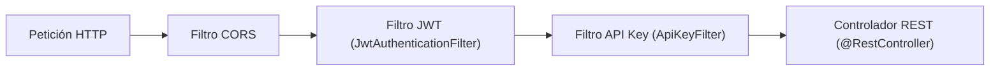
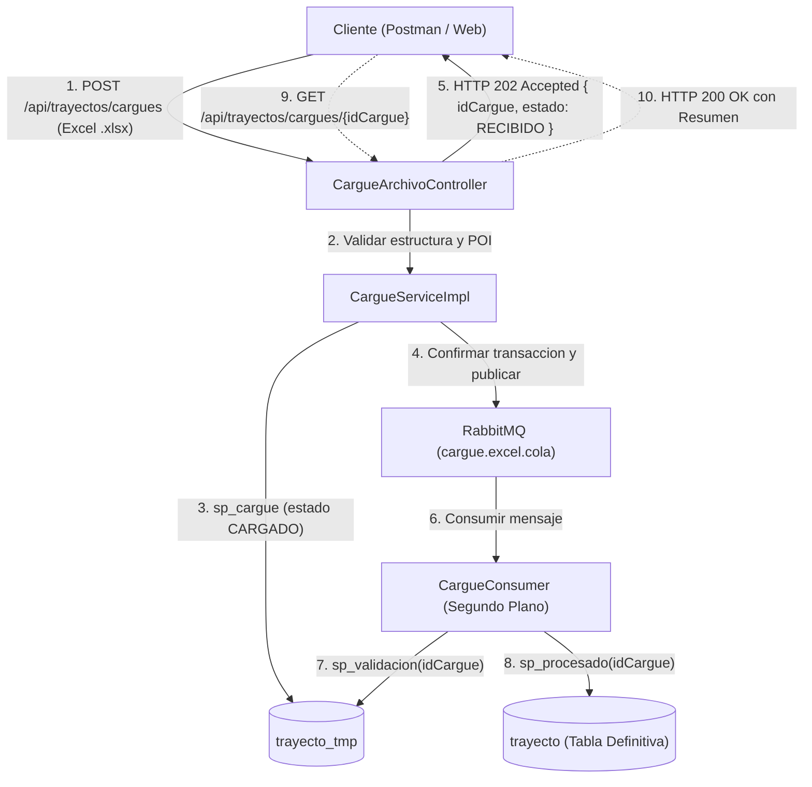

# Documentación de la API REST · Vehículos, Documentos y Trayectos

Esta API REST proporciona la gestión integral de **vehículos, documentos legales, conductores, rutas de transporte y cargue masivo de trayectos**. Dispone de seguridad por doble factor (**JWT + API Key**), geocodificación automática con **Google Maps**, ejecución de tareas programadas y procesamiento asíncrono desacoplado con **RabbitMQ**.

---

## 1. Información General y Tecnologías

- **Versión del Proyecto:** 0.0.1-SNAPSHOT (Spring Boot 4.0.8, Java 17).
- **URL Base:** `http://localhost:8080`
- **Manejador de Base de Datos:** MariaDB / MySQL (XAMPP o contenedor).
- **Mensajería Asíncrona:** RabbitMQ 3 (AMQP puerto 5672, Consola 15672).
- **Librería de Excel:** Apache POI 5.5.1 (`poi-ooxml`).

---

## 2. Esquema de Seguridad y Autenticación

La API utiliza un esquema de **autenticación stateless con dos cabeceras obligatorias** en todos los endpoints protegidos:

1. **`Authorization: Bearer <token_jwt>`**: Obtenido mediante el endpoint público de inicio de sesión (`POST /api/auth/login`). Válido por 1 hora.
2. **`X-API-Key: <api_key>`**: Cadena UUID única asignada al usuario administrativo en la base de datos (tabla `usuario`).



> **Nota:** Si las credenciales son inválidas o ausentes, la API responde con estado `HTTP 401 Unauthorized`.

---

## 3. Formato Estándar de Respuesta de Errores

Todos los errores y validaciones de negocio fallidas se unifican mediante el manejador global de excepciones (`GlobalExceptionHandler`) con el objeto `ErrorResponseDTO`:

```json
{
  "fecha": "2026-11-03T23:45:00",
  "estado": 400,
  "mensaje": "Mensaje descriptivo del error o regla de negocio no cumplida",
  "detalles": null
}
```

---

## 4. Catálogo Completo de Endpoints

### 4.1. Módulo de Autenticación (`/api/auth`)

#### Iniciar Sesión (Público)
- **Método:** `POST`
- **Ruta:** `/api/auth/login`
- **Cabeceras:** `Content-Type: application/json`
- **Cuerpo de la Petición:**
  ```json
  {
    "login": "ad1000000001",
    "password": "mi-password-secreto"
  }
  ```
- **Respuesta Exitosa (`HTTP 200 OK`):**
  ```json
  {
    "token": "eyJhbGciOiJIUzI1NiJ9.eyJzdWIiOiJhZDEwMDAwMDAwMDEiLCJpYXQiOjE3OTM..."
  }
  ```

---

### 4.2. Módulo de Consultas Públicas (`/api/publico`)
*No requieren token JWT ni API Key.*

| Método | Ruta | Descripción | Parámetros |
|---|---|---|---|
| `GET` | `/api/publico/vehiculos/documentos-vencidos` | Lista vehículos cuyos documentos están en estado `Vencido`. | Ninguno |
| `GET` | `/api/publico/vehiculos/documentos-por-vencer` | Vehículos con documentos a vencer en una ventana de días. | `dias` (Query Param, ej: `?dias=30`) |
| `GET` | `/api/publico/conductores-disponibles` | Conductores en estado `PO` (Puede Operar). | Ninguno |
| `GET` | `/api/publico/vehiculos/placa/{placa}` | Información detallada de un vehículo por su placa. | `placa` (Path Param, ej: `/ABC123`) |
| `GET` | `/api/publico/personas/conteo-por-tipo` | Conteo de personas registradas (`C` conductor o `A` administrativo). | Ninguno |
| `GET` | `/api/publico/trayectos/rutas-restringidas` | Rutas donde el vehículo no está habilitado o el conductor está restringido (`RO`). | Ninguno |

---

### 4.3. Módulo de Vehículos y Documentos (`/api/vehiculos`, `/api/documentos`)
*Protegidos: Requieren `Authorization: Bearer <token>` y `X-API-Key: <key>`.*

| Método | Ruta | Descripción |
|---|---|---|
| `GET` | `/api/vehiculos` | Listar todos los vehículos. |
| `POST` | `/api/vehiculos` | Crear un vehículo con al menos un documento inicial (`En verificacion`). |
| `GET` | `/api/vehiculos/{id}` | Consultar vehículo por ID numérico. |
| `PUT` | `/api/vehiculos/{id}` | Actualizar datos del vehículo. |
| `DELETE` | `/api/vehiculos/{id}` | Eliminar vehículo. |
| `GET` | `/api/vehiculos/placa/{placa}` | Buscar por placa exacta. |
| `GET` | `/api/vehiculos/tipo/{tipoVehiculo}` | Filtrar por tipo (ej: `AUTOMOVIL`, `BUS`). |
| `GET` | `/api/vehiculos/documento/{idDocumento}` | Vehículos que tienen asignado un documento específico. |
| `GET` | `/api/vehiculos/estado-documento/{estado}` | Vehículos con documentos en un estado (ej: `Habilitado`, `Vencido`). |
| `POST` | `/api/vehiculos/{id}/documentos` | Asociar documento legal a un vehículo existente. |
| `POST` | `/api/vehiculos/{id}/documentos/pdf` | Cargar el soporte en PDF codificado en Base64 (`LONGBLOB`). |
| `GET` | `/api/documentos` | CRUD del catálogo maestro de tipos de documentos legales. |

---

### 4.4. Módulo de Personas, Usuarios y Conductores (`/api/personas`, `/api/usuarios`)

| Método | Ruta | Descripción |
|---|---|---|
| `GET` | `/api/personas` | Listar todas las personas registradas. |
| `POST` | `/api/personas` | Crear persona. Si es administrativa (`A`), genera automáticamente su usuario, contraseña y API Key. |
| `PUT` | `/api/usuarios/{login}/password` | Cambiar la contraseña del usuario. |
| `GET` | `/api/usuarios/{login}/apikey` | Regenerar y retornar una nueva API Key para el usuario. |
| `POST` | `/api/vehiculos/{id}/conductores` | Asociar un conductor a un vehículo con estado inicial `EA` (En espera). |
| `GET` | `/api/vehiculos/{id}/conductores` | Consultar conductores vinculados a un vehículo. |
| `PUT` | `/api/vehiculos/{id}/conductores/{idPersona}/estado` | Cambiar estado del conductor (`PO`: Puede Operar, `RO`: Restringido, `EA`: Espera). |

---

### 4.5. Módulo de Trayectos Convencionales (`/api/trayectos`)

#### Crear Ruta (Sincrónica)
- **Método:** `POST`
- **Ruta:** `/api/trayectos/rutas`
- **Cuerpo:** Lista de entre 2 y 7 paradas compartiendo el mismo conductor y vehículo.
- **Validaciones:** Conductor en `PO`, todos los documentos del vehículo en `Habilitado`, órdenes de parada consecutivos sin saltos (0, 1, ..., n-1).

#### Consultar Rutas
| Método | Ruta | Descripción |
|---|---|---|
| `GET` | `/api/trayectos/rutas/{codigoRuta}` | Consultar las paradas de una ruta ordenadas por `ordenParada`. |
| `GET` | `/api/trayectos/conductores/{identificacion}/rutas` | Códigos de ruta asignados a un conductor. |
| `GET` | `/api/trayectos/vehiculos/{placa}/rutas` | Rutas agrupadas asignadas a un vehículo con resumen del conductor. |

---

### 4.6. Módulo de Cargue Masivo de Trayectos (Entrega 4)

Este módulo permite importar rutas masivamente mediante una plantilla de **Excel (`.xlsx`)**, validando reglas de negocio complejas en base de datos temporal con **procedimientos almacenados** y ejecución asíncrona desacoplada con **RabbitMQ**.



---

#### 4.6.1. Especificación de la Plantilla Excel (`.xlsx`)
1. **Extensión obligatoria:** `.xlsx` (máximo 2 MB por petición).
2. **Nombre de la hoja:** Debe llamarse exactamente `Trayectos` (con mayúscula inicial).
3. **Fila 1 (Encabezados exactos en orden):**
   | Columna | Nombre del encabezado | Descripción |
   |---|---|---|
   | A | `id_persona` | ID numérico del conductor en la base de datos. |
   | B | `id_vehiculo` | ID numérico del vehículo asociado. |
   | C | `codigo_ruta` | Código identificador de la ruta (máx 50 caracteres). |
   | D | `ubicacion` | Dirección o punto de parada (máx 255 caracteres). |
   | E | `orden_parada` | Número entero secuencial de la parada (0 a n-1). |
   | F | `latitud` | Coordenada decimal opcional (-90 a 90). |
   | G | `longitud` | Coordenada decimal opcional (-180 a 180). |
4. **Cantidad de filas:** Mínimo 1 fila y máximo 500 filas de datos (se ignoran filas completamente vacías).

---

#### 4.6.2. Endpoint 1: Subir Archivo y Encolar Cargue
- **Método:** `POST`
- **Ruta:** `/api/trayectos/cargues`
- **Cabeceras:**
  - `Authorization: Bearer <token_jwt>`
  - `X-API-Key: <api_key>`
- **Content-Type:** `multipart/form-data`
- **Parámetro del Body:** `archivo` (Tipo File, archivo `.xlsx`)

##### Respuesta Exitosa (`HTTP 202 Accepted`):
```json
{
  "idCargue": 202611032350,
  "totalFilas": 3,
  "estado": "RECIBIDO",
  "mensaje": "El archivo fue recibido exitosamente y su validación está encolada para procesamiento en segundo plano."
}
```

##### Errores Posibles (`HTTP 400 Bad Request`):
- Archivo nulo o vacío (`"El archivo no puede ser nulo ni estar vacío."`).
- Extensión distinta a `.xlsx` (`"El archivo debe tener extensión .xlsx."`).
- Archivo corrupto o PDF renombrado (`"El archivo no es un Excel .xlsx válido."`).
- Falta la hoja `Trayectos` (`"El archivo no contiene la hoja llamada 'Trayectos'."`).
- Encabezados incorrectos (`"Encabezado inválido en la columna 1: se esperaba 'id_persona'."`).
- Fuera del rango permitido (`"El archivo debe contener entre 1 y 500 filas de datos."`).
- Concurrencia por minuto (`"Ya hay un cargue en este minuto; espera un minuto e inténtalo de nuevo."`).

---

#### 4.6.3. Endpoint 2: Consultar Avance y Resumen del Cargue
- **Método:** `GET`
- **Ruta:** `/api/trayectos/cargues/{idCargue}`
- **Cabeceras:** `Authorization` y `X-API-Key`

##### Respuesta Exitosa (`HTTP 200 OK`):
```json
{
  "idCargue": 202611032350,
  "totalFilas": 3,
  "resumen": {
    "CARGADO": 0,
    "VALIDADO": 0,
    "PROCESADO": 3,
    "ERROR": 0
  }
}
```

##### Ciclo de Vida de los Estados en `trayecto_tmp`:
- **`CARGADO`**: Estado inicial al insertar la fila tal cual desde el Excel mediante `sp_cargue`.
- **`VALIDADO`**: Asignado por `sp_validacion` a las paradas cuyas rutas cumplen todas las reglas de negocio (conductor PO, vehículo habilitado, ruta con 2 a 7 paradas, orden 0..n-1).
- **`PROCESADO`**: Asignado por `sp_procesado` tras trasladar exitosamente las paradas validadas a la tabla definitiva `trayecto`.
- **`ERROR`**: Asignado si la parada o su ruta asociada falló alguna validación. El detalle de la falla queda registrado en la columna `observacion`.

---

## 5. Configuración de RabbitMQ

El procesamiento asíncrono se apoya en una topología robusta con política de reintentos y Dead Letter Queue (DLQ):

- **Exchange Principal:** `cargue.direct.exchange` (Direct).
- **Cola Principal:** `cargue.excel.cola` (Routing Key: `cargue.excel.key`).
- **Dead Letter Exchange (DLX):** `cargue.dlx.exchange`.
- **Dead Letter Queue (DLQ):** `cargue.excel.dlq` (Routing Key: `cargue.excel.dlq.key`).
- **Reintentos:** 3 intentos automáticos con multiplicación de tiempo exponencial (`initial-interval=1000ms`, `multiplier=2.0`). Si agota los 3 intentos, el mensaje se descarta de la cola principal y se traslada a la cola `cargue.excel.dlq` para revisión.

### Levantar RabbitMQ con Docker en 1 Comando:
```bash
docker compose up -d
```
Consola Web de RabbitMQ: [http://localhost:15672](http://localhost:15672) (Usuario: `guest` / Clave: `guest`).

---

## 6. Generación de Archivos de Prueba

En la carpeta de pruebas (`src/test/java/com/utolima/vehiculosdocumentosapi/GenerarExcelPrueba.java`) se encuentra la clase utilitaria para generar los archivos de prueba con un solo clic:
- `postman/cargue_exitoso.xlsx`: 3 paradas válidas para la ruta `RUTA-EXCEL-01`.
- `postman/cargue_mixto.xlsx`: Una ruta válida (2 paradas) y una ruta con error (1 parada y conductor inexistente 999).
- `postman/cargue_encabezado_invalido.xlsx`: Para validar rechazo por encabezados erróneos (HTTP 400).
- `postman/cargue_mas_de_500_filas.xlsx`: Para validar rechazo por exceso de filas (HTTP 400).

